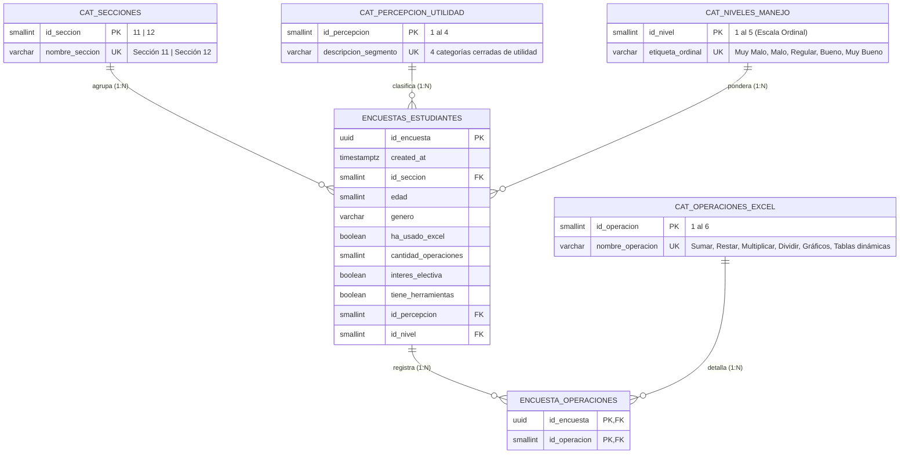

# Especificación del Sistema ETL y Modelo de Datos OLTP (`etl_system_design.md`)

**Proyecto:** Sistema OLTP de Evaluación del Nivel de Manejo de Excel — Propedéutico EECA-UCV[cite: 1, 2]  
**Arquitectura de Datos:** Tercera Forma Normal (3FN) en PostgreSQL (Supabase Cloud)[cite: 1]  
**Stack de Integración:** Python, SDK Oficial de Supabase (`supabase-py`), Pandas, Matplotlib y Streamlit[cite: 1]  

---

## 1. Mapeo de Operacionalización de Variables al Modelo Relacional (3FN)

El instrumento de recolección de datos evalúa 10 variables estadísticas sobre los estudiantes del propedéutico de la Escuela de Estadística y Ciencias Actuariales (Sección 11 y Sección 12)[cite: 2]. Para transformar el cuestionario en un sistema transaccional OLTP normalizado en Tercera Forma Normal (3FN) sin redundancias ni grupos repetitivos, se aplican las siguientes reglas de modelado[cite: 1, 2]:

| N° | Variable Estadística | Tipo y Escala | Regla de Negocio e Implementación en 3FN |
| :-: | :--- | :--- | :--- |
| **1** | Sección del propedéutico[cite: 2] | Cualitativa Dicotómica (Nominal)[cite: 2] | Clave foránea (`id_seccion`) referenciando al catálogo `cat_secciones` (`Sección 11`, `Sección 12`)[cite: 2]. |
| **2** | Edad en años[cite: 2] | Cuantitativa Discreta (Razón)[cite: 2] | Atributo entero (`SMALLINT`) en `encuestas_estudiantes` validado en el rango `15 <= edad <= 75`. |
| **3** | Género[cite: 2] | Cualitativa Dicotómica (Nominal)[cite: 2] | Atributo `VARCHAR(15)` restringido a `'Femenino'` o `'Masculino'`[cite: 2]. |
| **4** | Si ha usado o no Excel[cite: 2] | Cualitativa Dicotómica (Nominal)[cite: 2] | Atributo booleano (`ha_usado_excel BOOLEAN NOT NULL`). |
| **5** | Cuántas operaciones básicas realiza[cite: 2] | Cuantitativa Discreta (Razón: 0 a 6) | **Atributo Calculado por el ETL (`cantidad_operaciones`):** No se solicita manualmente al usuario para evitar contradicciones con la Pregunta 6. El ETL calcula `len(operaciones_seleccionadas)` de forma automática. |
| **6** | Operaciones básicas que puede realizar[cite: 2] | Cualitativa Politómica (Nominal)[cite: 2] | **Desacoplamiento $N:M$ (1FN a 3FN):** Se normaliza mediante el catálogo `cat_operaciones_excel` y la tabla puente `encuesta_operaciones`. |
| **7** | Interés en materia electiva de Excel[cite: 2] | Cualitativa Dicotómica (Nominal)[cite: 2] | Atributo booleano (`interes_electiva BOOLEAN NOT NULL`). |
| **8** | Disponibilidad de herramientas tecnológicas[cite: 2] | Cualitativa Dicotómica (Nominal)[cite: 2] | Atributo booleano (`tiene_herramientas BOOLEAN NOT NULL`). |
| **9** | Percepción de beneficio profesional y académico[cite: 2] | Cualitativa Politómica (Nominal)[cite: 2] | Clave foránea (`id_percepcion`) hacia `cat_percepcion_utilidad` (tipificando los 4 segmentos cerrados del estudio)[cite: 2]. |
| **10** | Percepción respecto a su manejo de Excel[cite: 2] | Cualitativa Politómica (Ordinal)[cite: 2] | Clave foránea (`id_nivel`) hacia `cat_niveles_manejo`, conservando el orden jerárquico del `1` (Muy Malo) al `5` (Muy Bueno)[cite: 2]. |

---

## 2. Diagrama Entidad-Relación (DER)



---

## 3. Especificación del Esquema Relacional en PostgreSQL (Supabase)

Este esquema define la estructura en Supabase. **Directiva para Agentes:** La aplicación en Python tiene estrictamente prohibido ejecutar consultas SQL concatenadas; toda interacción con estas tablas debe realizarse a través de los métodos del SDK de Supabase (`supabase.table(...).insert(...)` y `.select(...)`).

```sql
-- 1. Catálogo de Secciones del Propedéutico (Variable 1)
CREATE TABLE cat_secciones (
    id_seccion SMALLINT PRIMARY KEY,
    nombre_seccion VARCHAR(20) UNIQUE NOT NULL
);

INSERT INTO cat_secciones (id_seccion, nombre_seccion) VALUES
(11, 'Sección 11'),
(12, 'Sección 12');

-- 2. Catálogo de Operaciones Básicas en Excel (Variable 6)
CREATE TABLE cat_operaciones_excel (
    id_operacion SMALLINT PRIMARY KEY,
    nombre_operacion VARCHAR(50) UNIQUE